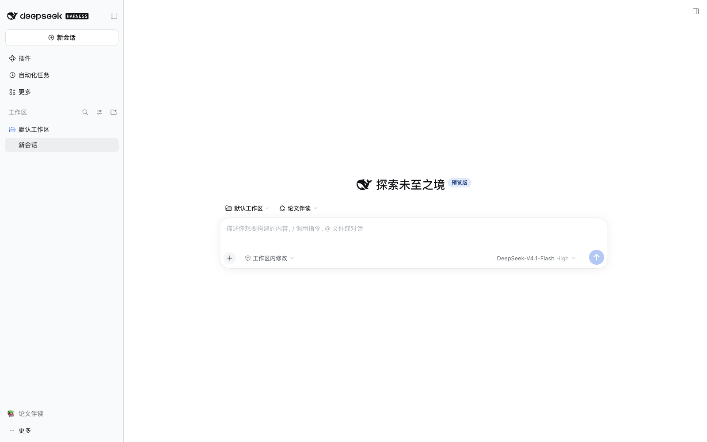
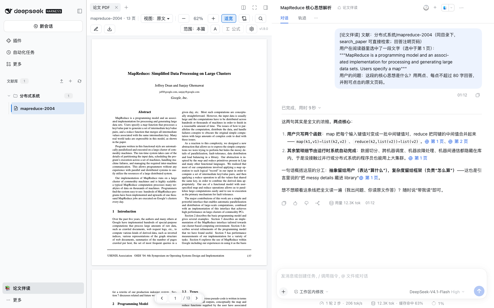
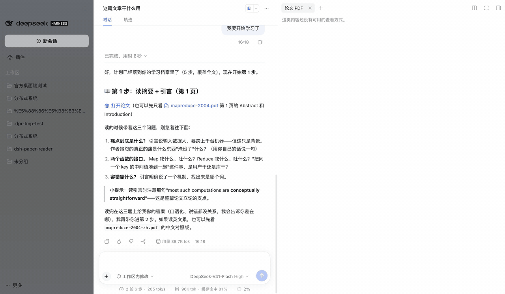

# dsh-paper-reader

[](https://www.npmjs.com/package/@ggboy123/dsh-paper-reader)
[](https://www.npmjs.com/package/@ggboy123/dsh-paper-reader)
[](https://github.com/GGboya/dsh-paper-reader/blob/main/LICENSE)
[](https://github.com/GGboya/dsh-paper-reader/stargazers)

**English**: [README_EN.md](README_EN.md)

[DeepSeek Harness (dsh)](https://github.com/deepseek-ai/deepseek-harness) 插件：**论文伴读工作台** —— 文献库 + PDF 阅读器 + AI 伴读，回答自带页码、点页码跳回原文。当前版本 **v1.12.1**。

> 💬 **QQ 交流群：1127244508** —— 安装/使用问题、功能建议、bug 反馈都欢迎来聊。

## 为什么

1. **论文一多，文件和阅读进度就容易乱。** 按专题整理论文，每篇论文的 PDF、译文、笔记和学习记录收在一起；改名、移动、删除（可从回收站恢复）都有管理入口。
2. **翻译不该打断阅读。** 不用来回复制粘贴——中文直接生成在原 PDF 版面上：纯中文、中英对照、左右分屏、划词翻译，公式也保留。
3. **AI 的回答需要能核对。** 回答自带页码，点击跳回原文并高亮；可以只问当前论文，也可以把范围扩大到整个专题，减少「答得流畅却找不到出处」。






## 特点

- 🔌 **零配置、不打扰**：装完即用——翻译直接跟随 Harness 当前模型与账号授权，不用申请、复制任何 Key；不改动官方界面，侧栏只多一行开关
- 🔒 **本地优先**：PDF、译文、笔记、学习记录都是文献文件夹里的普通文件，把 `data/` 目录拷走就都带得走；未配置第三方端点时，插件不向任何外部服务发请求（伴读对话历史与端点设置存在 dsh 一侧，不随文件夹迁移）
- ➕ **可选增强，默认关闭**：MinerU 解析让扫描件可读、公式可点引用可检索；嵌入端点让大白话提问也能命中术语段落——不配置就一条请求都不发
- ⚡ **长文档不卡**：只渲染视口附近的页，原文 ↔ 中文切换零重载，重开论文不重传 PDF
- 🤖 **教练式带读（可选）**：AI 制定分步计划，你读原文、作答，答好才继续，学习进度跨会话累积
- 🌙 **PDF 深色模式**：跟随 dsh 主题，四档强度可调（整页反色实现，图片会褪色偏色——已知代价，可一键关）

> 各功能的前提、代价与已知限制统一放在 [docs/features.md](docs/features.md)；配置 MinerU、嵌入或翻译端点前，建议先读对应小节。

## 安装

### 普通用户：桌面端装好即用（推荐）

**两步**：装 DeepSeek 官方桌面端 → 里面直接装插件。

1. 下载安装 [DeepSeek 官方桌面端](https://www.deepseek.com/download/)（即 DeepSeek Harness 桌面版），登录 DeepSeek 账号
2. 侧栏 → **插件** → **添加插件**，输入 `@ggboy123/dsh-paper-reader@latest`，装完点进插件详情打开「启用」开关，**重启桌面端**

完成。侧栏底部点「📚 论文伴读」进入文献库，上传 PDF 开始用。



> 需要官方桌面端 V0.2.0-rc.2 或更新版本（内置 dsh ≥0.2.0-rc.2）；dsh 0.1.5 不再支持。

<details>
<summary><b>安装排坑（都实测踩过）</b></summary>

- **升级后插件开关会回到停用**：重新打开「启用」并重启。症状有迷惑性——文献树还在但点论文没反应
- **添加务必带 `@latest`**：不带版本号对已装过的插件是 no-op，不会追新
- pnpm 供应链策略 `minimumReleaseAge` 拦新包时：等过窗口期，或把本包加进豁免清单（`~/.dsh/profiles/web/.npmrc` 的 `minimum-release-age-exclude[]`；桌面端在 `~/.dsh/profiles/desktop/pnpm-workspace.yaml` 的 `minimumReleaseAgeExclude`）
- 想逛插件市场，可另装社区插件 [`dshmarket`](https://github.com/dsh-market/dsh-market)，本插件已在其目录中

</details>

### 开发者：命令行 dsh

```bash
dsh plugin --profile web add @ggboy123/dsh-paper-reader@latest   # 升级也是这条；不带版本号是 no-op
```

> 不要用 `github:GGboya/dsh-paper-reader` 安装 —— dist 不入库，git 安装会导致 profile 起不来。

## 快速上手

1. **进入**：侧栏底部点「📚 论文伴读」（再点还原）
2. **入库**：＋ 新建专题 → ⬆ 上传 PDF
3. **读 + 问**：直接提问（回答自带页码），或选中文字弹框提问；点「第 N 页」跳回原文
4. **中文版**：顶栏「中」一键生成；需要专用翻译模型时，在「设置 → 论文伴读 → 全文翻译模型」里单独配置
5. **管理**：行悬停点「⋯」，文件名原地改名（Enter 保存 / Esc 取消），论文可移动到其它专题，也可删除；对话头部 🕐 历史、＋ 新开

## 数据与安全

- 所有数据都是本地文件：文献库默认在 `~/.dsh-paper-reader/data`（可在 profile 改）；插件自身的端点凭据落盘 `$DSH_HOME/.dsh-paper-reader/`（权限 0600，界面只回掩码）
- 删除 = **移入回收站** `data/.trash/`（带 manifest，移回即恢复），会一并处理该文献的全部产物：`<文献>.pdf`、`.txt`、`.pages.json`、`.transcript.json`、`.mineru.md`、`.mineru.json`、`.embeddings.json`、`.study.json`、`.notes.json` 与译文变体 `<文献>-en.pdf` / `-zh.pdf` / `-dual.pdf`（含 `.tmp-*` 残留）；伴读会话历史不删
- 有运行中会话或翻译中的文献会被前置拒绝；路径穿越（`..`、绝对路径、符号链接逃逸）一律拒绝；操作中途失败自动回滚

## 参与开发

```bash
git clone https://github.com/GGboya/dsh-paper-reader
cd dsh-paper-reader && pnpm install && pnpm run build
dsh plugin --profile web add ./dsh-paper-reader   # 从父目录执行，或用绝对路径
dsh --profile web                                  # 侧栏变为文献库树
```

改完 `pnpm run build` 重启 profile 即生效；`npm test` 跑全量测试（CI 跑 ubuntu / macOS / Windows 三平台）。架构、测试守卫与开发约定见 [AGENTS.md](AGENTS.md)。

## 贡献者

感谢每一位贡献者：

<a href="https://github.com/GGboya/dsh-paper-reader/graphs/contributors">
  
</a>

## Star 趋势

[](https://star-history.com/#GGboya/dsh-paper-reader&Date)

## License

MIT
