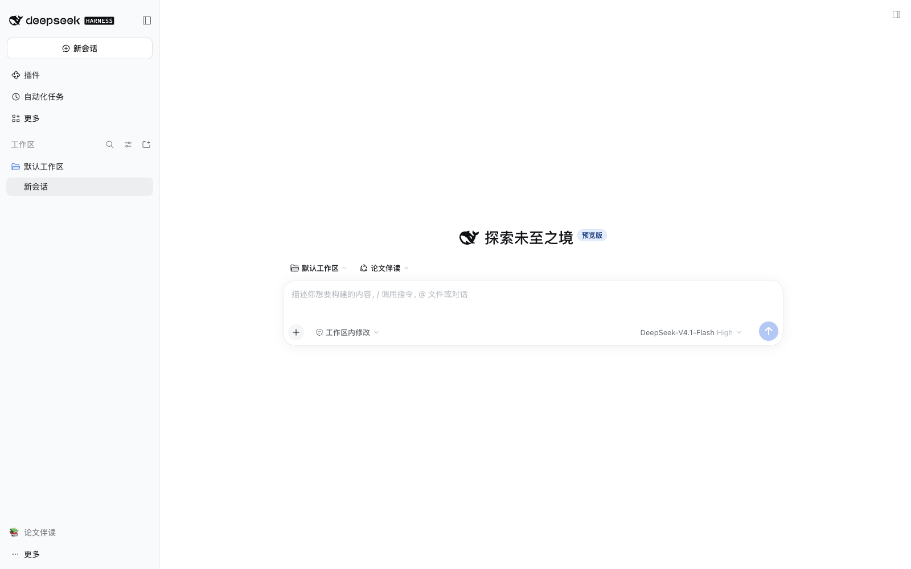
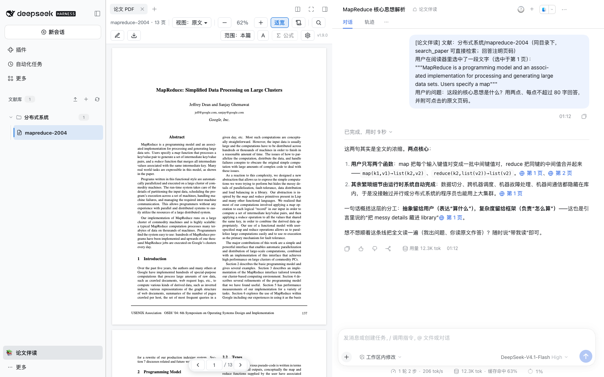
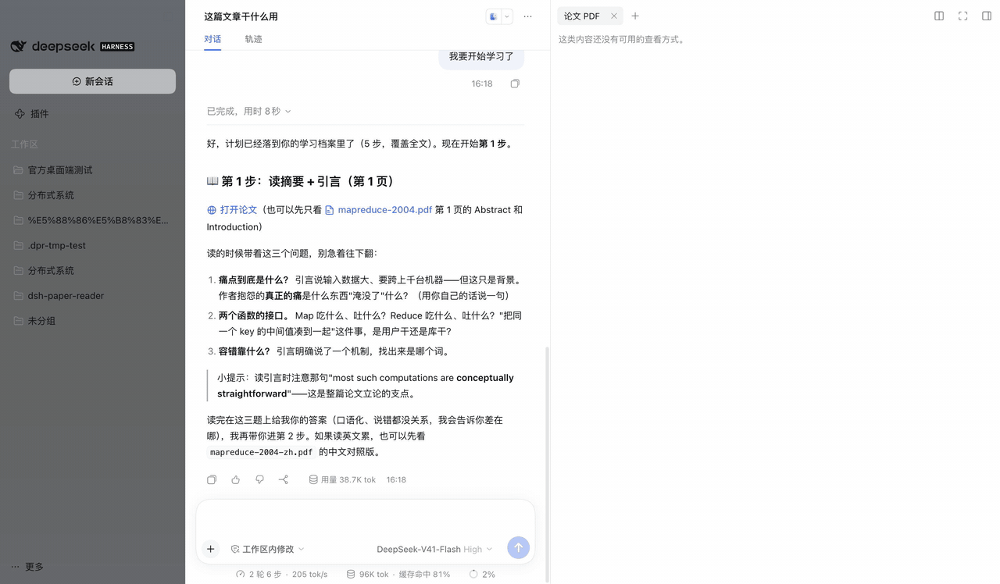

# dsh-paper-reader

[](https://www.npmjs.com/package/@ggboy123/dsh-paper-reader)
[](https://www.npmjs.com/package/@ggboy123/dsh-paper-reader)
[](https://github.com/GGboya/dsh-paper-reader/blob/main/LICENSE)
[](https://github.com/GGboya/dsh-paper-reader/stargazers)

**中文**: [README.md](README.md)

A [DeepSeek Harness (dsh)](https://github.com/deepseek-ai/deepseek-harness) plugin: a **paper reading workbench** — paper library + PDF reader + AI companion. Every answer cites page numbers, and clicking a page jumps back to the exact highlighted passage. Current version: **v1.12.0**.

> 💬 **QQ group: 1127244508** — questions, feature requests, and bug reports are all welcome.

## Why

1. **A growing paper library gets messy fast.** Organize papers into topics and subtopics, with each paper's PDF, translations, notes, and study progress kept together. Rename, move, or delete papers from one place — deletions can be recovered from the trash.
2. **Translation should not interrupt reading.** No copying paragraphs into another app: Chinese is generated directly on the original PDF layout — Chinese-only, bilingual, split-view, and selection translation, formulas included.
3. **AI answers need verifiable evidence.** Answers cite page numbers that jump straight to the highlighted source. Ask about one paper or an entire topic, so fluent answers never leave you searching for the evidence yourself.






## Highlights

- 🔌 **Zero-config, non-intrusive**: works right after install — translation follows the current Harness model and account authorization, no API keys to copy; the official UI is untouched, just one extra toggle in the sidebar
- 🔒 **Local-first**: PDFs, translations, notes, and study records are plain files inside each paper's folder — copy the `data/` directory and they all come along; with no optional endpoint configured, the plugin sends no requests to any external service (chat history and endpoint settings live on the dsh side and do not follow the folder)
- ➕ **Optional add-ons, off by default**: MinerU parsing makes scanned PDFs readable and formulas **Click to cite a formula** and searchable; an embeddings endpoint lets plain-language queries hit jargon passages — not a single request until you configure them
- ⚡ **Smooth on long papers**: only pages near the viewport are painted; original ↔ Chinese switching reloads nothing; reopening a paper re-uploads nothing
- 🤖 **Optional tutor mode**: the AI makes a step-by-step plan; you read the original and answer, and it advances you only after you demonstrate understanding — progress accumulates across sessions
- 🌙 **PDF dark mode**: follows the dsh theme with four strength presets (whole-page inversion, so photos desaturate and shift — a known cost, one click to turn off)

> Prerequisites, costs, and known limits of every feature live in [docs/features_EN.md](docs/features_EN.md); read the relevant section before configuring MinerU, embeddings, or translation endpoints.

## Install

### Everyday users: official desktop app (recommended)

**Two steps**: install the official DeepSeek desktop app → add the plugin inside it.

1. Install [the official DeepSeek desktop app](https://www.deepseek.com/download/) (the DeepSeek Harness desktop) and sign in
2. Sidebar → **Plugins** → **Add plugin**, enter `@ggboy123/dsh-paper-reader@latest`, open the plugin's detail page and flip the **Enable** switch, then **restart the app**

Done. Click "📚 Paper Reading" at the bottom of the sidebar, upload a PDF, and start reading.



> Requires official desktop V0.2.0-rc.2 or newer (bundled dsh ≥0.2.0-rc.2); dsh 0.1.5 is no longer supported.

<details>
<summary><b>Installation pitfalls (all hit in real testing)</b></summary>

- **After upgrading, the enable switch resets to off**: flip **Enable** again and restart. The symptom is misleading — the library tree is still there but clicking papers does nothing
- **Always add with `@latest`**: a bare add on an already-installed plugin is a no-op
- If pnpm's `minimumReleaseAge` policy blocks the new package: wait out the window, or exempt this package (`minimum-release-age-exclude[]` in `~/.dsh/profiles/web/.npmrc`; on desktop, `minimumReleaseAgeExclude` in `~/.dsh/profiles/desktop/pnpm-workspace.yaml`)
- To browse a plugin marketplace inside the client, also install the community plugin [`dshmarket`](https://github.com/dsh-market/dsh-market); this plugin is listed there

</details>

### Developers: CLI dsh

```bash
dsh plugin --profile web add @ggboy123/dsh-paper-reader@latest   # same command upgrades; a bare add is a no-op
```

> Do NOT install via `github:GGboya/dsh-paper-reader` — dist is not committed, so a git install leaves the profile unable to start.

## Quick start

1. **Enter**: click "📚 Paper Reading" at the bottom of the sidebar (click again to restore)
2. **Add papers**: ＋ create a topic → ⬆ upload PDFs
3. **Read + ask**: just ask (answers cite pages), or select text for a pop-up question; click "page N" to jump back
4. **Chinese version**: the "中" button generates a translation; configure a dedicated translation model under **Settings → Paper Reader → Translation model** only when needed
5. **Manage**: hover a row and open **⋯** to rename inline (Enter saves, Esc cancels), move a paper to another topic, or delete; 🕐 in the chat header shows history, ＋ starts a new chat

## Data & safety

- Everything is a local file: the library defaults to `~/.dsh-paper-reader/data` (configurable in the profile); the plugin's own endpoint credentials live in `$DSH_HOME/.dsh-paper-reader/` (mode 0600, masked in the UI)
- Deletion = **moved to trash** `data/.trash/` (with a manifest; move files back to recover); it handles every artifact of the paper: `<paper>.pdf`, `.txt`, `.pages.json`, `.transcript.json`, `.mineru.md`, `.mineru.json`, `.embeddings.json`, `.study.json`, `.notes.json`, plus translation variants `<paper>-en.pdf` / `-zh.pdf` / `-dual.pdf` (including leftover `.tmp-*`); chat history is not deleted
- Papers with a running session or an in-flight translation are refused up front; path traversal is rejected and mid-way failures roll back

## Contributing

```bash
git clone https://github.com/GGboya/dsh-paper-reader
cd dsh-paper-reader && pnpm install && pnpm run build
dsh plugin --profile web add ./dsh-paper-reader   # run from the parent dir, or use an absolute path
dsh --profile web                                  # sidebar becomes the library tree
```

After changes, `pnpm run build` and restart the profile; `npm test` runs the full suite (CI on ubuntu / macOS / Windows). Architecture, test guards and dev conventions: see [AGENTS.md](AGENTS.md).

## Contributors

Thanks to everyone who has contributed:

<a href="https://github.com/GGboya/dsh-paper-reader/graphs/contributors">
  
</a>

## Star History

[](https://star-history.com/#GGboya/dsh-paper-reader&Date)

## License

MIT
